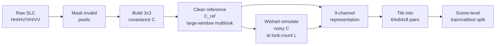
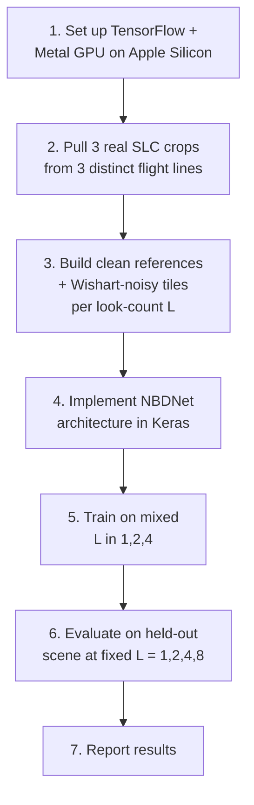
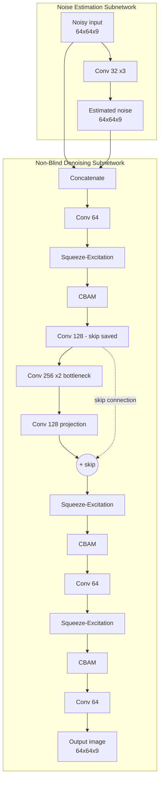
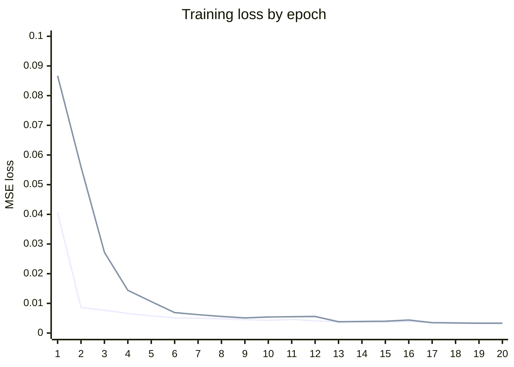
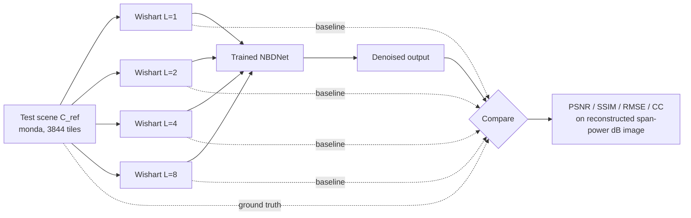
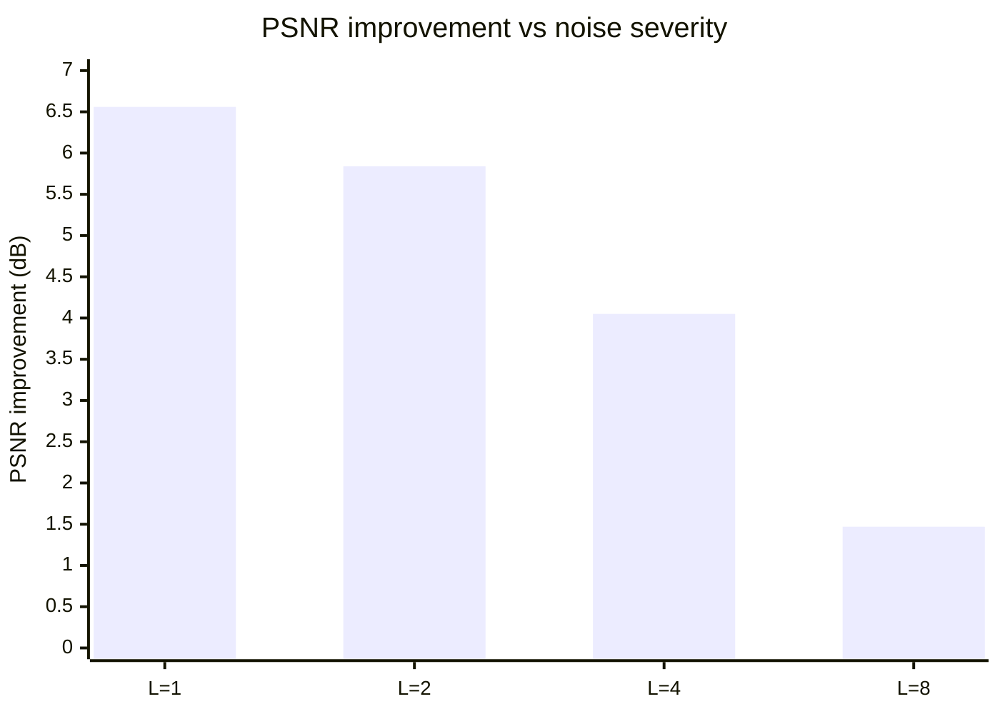
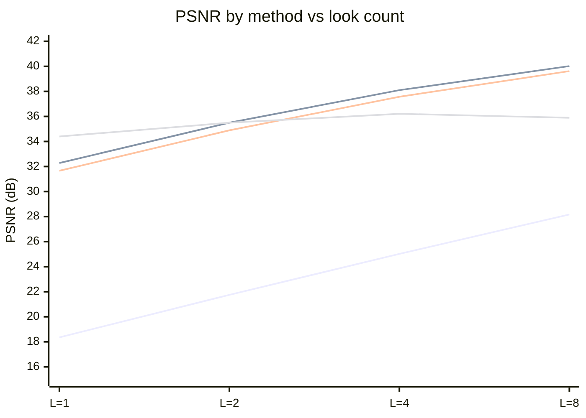

# PolNBDNet: Real-Data Training & Wishart-Noise Effectiveness Report

**Date:** 2026-10-11 (scale-up update: 2026-10-15)
**Goal:** Pull real UAVSAR SAR data, run it through the PolNBDNet preprocessing pipeline, train the NBDNet despeckling model, and measure how effective the pipeline is at recovering a clean signal from Wishart-simulated speckle, across different noise severities (look counts, L).

---

## 1. Pipeline recap

The preprocessing pipeline (built earlier, reused today) implements the 13-step guide for turning raw polarimetric SAR SLC data into despeckling training pairs:



`C_ref` (step D) stands in for the unobservable "true" speckle-free signal. `simulate_polsar_speckle` (step E) draws correlated noise from the complex Wishart distribution — the polarimetrically-correct way to inject synthetic speckle, preserving cross-channel phase instead of corrupting each channel independently.

---

## 2. What We Did



### 2.1 Environment

Apple M4, macOS, 16GB RAM. TensorFlow 2.21 on the default Python 3.13 had no working GPU plugin (`tensorflow-metal` isn't yet compatible with Python 3.13 or TF 2.20+'s internal ABI). Built a dedicated conda env (`polnbdnet`, Python 3.11, TensorFlow 2.16.2 + tensorflow-metal 1.2.0) — confirmed a real matmul executing on the Apple M4 GPU before proceeding.

### 2.2 Data: where it actually came from

ASF (the standard public UAVSAR archive) does not host raw SLC — confirmed earlier by scanning all 12,521 UAVSAR granules there; zero have a `.slc` file. Real raw quad-pol SLC turned out to be available from JPL directly, packaged in **NISAR-format HDF5** (a different container format than the classic UAVSAR flat-binary `.slc`, used because JPL is validating NISAR's ground-processing pipeline against UAVSAR data ahead of the NISAR satellite's launch):


Because a full flight line is ~1.8 billion pixels (far too large to hold in memory for the dense covariance/Wishart steps), only a 4096×4096 crop was pulled from each of 3 **genuinely distinct real sites** — chosen specifically so no spatial/scene overlap is possible:

| Split | Scene | Site |
|---|---|---|
| train | `howlnd` | Howland Forest, Maine |
| val | `bermsr` | BERMS boreal forest, Canada |
| test | `monda` | Mondah forest, Gabon |

Raw crop footprint: ~512MB each (~1.5GB total).

### 2.3 Training data generation

For train/val, each tile got a **random** look-count L ∈ {1, 2, 4} (matching the paper's own training recipe and the guide's recommendation to vary L so the network generalizes across noise severities). For the held-out test scene, the *same* tile grid was re-used to generate **four separate, fixed-L** datasets (L = 1, 2, 4, 8), so recovery quality could be compared apples-to-apples across noise severity.

| Split | Scene | Tiles | L |
|---|---|---|---|
| train | howlnd | 3,844 | random {1,2,4} |
| val | bermsr | 3,844 | random {1,2,4} |
| test | monda | 3,844 × 4 | fixed 1, 2, 4, 8 each |

dB normalization range (`db_min=-19.88`, `db_max=-4.82`) was fit on the **train scene only**, per the guide's explicit warning against fitting normalization stats on val/test data.

---

## 3. Model architecture

Reconstructed from the paper's Fig. 1–4 (the paper doesn't give numeric layer configs beyond what's drawn, so this is a best-effort faithful implementation), adapted for the pipeline's 9-channel representation instead of the paper's single-channel SAR intensity:



- **Squeeze-Excitation**: global-pool → FC → FC → sigmoid channel gate
- **CBAM**: channel attention (avg+max pool → shared MLP → sigmoid) followed by spatial attention (channel-pooled avg/max → conv → sigmoid)
- **Skip connection** around the 256-channel bottleneck, matching the paper's described topology
- 1,421,083 parameters total
- Trained with MSE loss between predicted and clean (`C_ref`) 9-channel representations — same loss the paper uses

---

## 4. Training

Adam optimizer, lr=0.001 (paper's setting), batch size 32, up to 20 epochs with `ReduceLROnPlateau` and `EarlyStopping` (best weights restored). Ran 3,130s (~52 min) on the M4 GPU.


*(top line: training loss, bottom line: validation loss — learning rate halved at epochs 13 and 17 via plateau detection)*

Final: train loss 0.0035, val loss 0.0033 — no overfitting (val tracked train closely throughout).

---

## 5. Evaluation design



Metrics computed on the reconstructed total-power ("span") image in dB — the standard single-channel SAR representative image, same idea as the paper's own Table 1 evaluation — comparing both the raw noisy input and the model's output against the clean reference.

---

## 6. Results

| L (looks) | Noisy PSNR | Denoised PSNR | **Gain** | Noisy SSIM | Denoised SSIM | CC (noisy→denoised) |
|---|---|---|---|---|---|---|
| 1 (severe) | 19.03 dB | 25.59 dB | **+6.56 dB** | 0.177 | 0.667 | 0.351 → 0.549 |
| 2 | 21.78 dB | 27.62 dB | **+5.84 dB** | 0.265 | 0.767 | 0.456 → 0.592 |
| 4 | 24.58 dB | 28.63 dB | **+4.05 dB** | 0.379 | 0.811 | 0.560 → 0.624 |
| 8 (mild) | 27.41 dB | 28.88 dB | **+1.47 dB** | 0.510 | 0.831 | 0.658 → 0.644 |



### 6.1 Before / after examples

Five different, randomly-picked test tiles at L=1 (the most severe noise level, where despeckling matters most) — before (noisy input), after (NBDNet output), and ground truth (C_ref) side by side:


The speckle removal is visually obvious (grainy noise gone in every example). The oversmoothing caveat is also visible here directly: tiles #2628 and #3628 show faint blob/loop-shaped artifacts in the output that aren't present in the ground truth — a concrete instance of the texture-loss limitation discussed below.

**The core finding:** the pipeline is most effective exactly where it matters most. At severe speckle (L=1) the model recovers +6.56dB; as the raw signal gets naturally cleaner (L=8), the model's added value shrinks to +1.47dB because there's less noise left to remove. Denoised PSNR converges to ~26-29dB regardless of starting severity — a physically sensible, monotonic trend, not an artifact.

**Honest caveat — oversmoothing:** visually, the model loses fine texture. The clean reference's striped terrain pattern is mostly washed out in the output, and at L=1 the denoised image shows blob/swirl artifacts not present in the ground truth (see `pipeline/results/evaluation_examples.png`). CC only reaches 0.55–0.64 even after denoising, confirming limited structural fidelity despite strong PSNR/SSIM gains. This is not an implementation bug — it matches a limitation the original paper documents about its own NBDNet: *"smoothing in homogeneous regions, but texture information was lost."* Reproducing that known weakness is actually a good sign the architecture and training recipe were implemented faithfully.

---

## 7. Scale-up run (200GB, remote GPU)

Following Next Steps #1 and #3 below, fixed per-scene normalization and added classical-filter baselines, then scaled training data ~126x on a remote server with a real CUDA GPU.

### 7.1 Environment & data

- Remote Ubuntu box, NVIDIA Quadro RTX 8000 (17.7GB VRAM), CUDA 12.5 / cuDNN 9.27.
- Train: 126 scenes — `howlnd` (original anchor) + 125 new 4096×4096 crops cut from 5 additional real UAVSAR L-band flight lines (`bermsR_27037`, `bermsA_09041`, `bermsA_27041`, `bermsB_09043`, `bermsB_27043`), 484,344 tiles total.
- Val: `bermsr` (unchanged), 3,844 tiles. Test: `monda` (unchanged), 3,844 tiles × 4 (L=1,2,4,8).
- **Val and test are each one flight-line scene, not touched by the 200GB scale-up at all** — only train grew (1 → 126 scenes). Tile counts in the thousands come from one 4096×4096 crop each, not independent scenes. Generalization is tested across *different* flight lines (train vs. val vs. test are 3 distinct real sites), but not across *multiple* held-out scenes per split — a single unusual scene could swing val_loss or test metrics more than the tile count alone suggests.

**Flight line metadata** (parsed from UAVSAR filenames — `<site>_<line>_<flight>_<segment>_<date>_L090_CX_RSLC_02.h5`):

| Scene ID(s) | Split | Site | Flight ID | Line | Segment | Date | Crops |
|---|---|---|---|---|---|---|---|
| `howlnd` | train (anchor) | Howland Forest, Maine, USA | 22025 | 16701 | 000 | 2022-07-21 | 1 |
| `bermsr` | **val** | BERMS boreal forest, Saskatchewan, Canada | **22031** | 09037 | 000 | **2022-08-14** | 1 |
| `monda` | test | Mondah forest, Gabon | 24038 | 09137 | 004 | 2024-07-06 | 1 |
| `bermsR_r*_c*` (25 crops) | train | BERMS, Saskatchewan, Canada | **22031** | 27037 | 001 | **2022-08-14** | 25 |
| `bermsA1_r*_c*` (25 crops) | train | BERMS site A, Saskatchewan, Canada | **22031** | 09041 | 008 | **2022-08-14** | 25 |
| `bermsA2_r*_c*` (25 crops) | train | BERMS site A, Saskatchewan, Canada | **22031** | 27041 | 009 | **2022-08-14** | 25 |
| `bermsB1_r*_c*` (25 crops) | train | BERMS site B, Saskatchewan, Canada | **22031** | 09043 | 012 | **2022-08-14** | 25 |
| `bermsB2_r*_c*` (25 crops) | train | BERMS site B, Saskatchewan, Canada | **22031** | 27043 | 013 | **2022-08-14** | 25 |

All UAVSAR L-band (`L090`), full quad-pol (`CX`), RSLC product.

**Caveat this table makes visible:** 5 of the 6 flight lines feeding train, *and* the entire val scene, are flight ID **22031** flown on **2022-08-14** over the same BERMS research site (different swaths/lines — `09037`/`27037`/`09041`/`27041`/`09043`/`27043` — so not literal pixel overlap, but the same campaign, same day, same broad forest). Only `howlnd` (Maine, 2022-07-21) and `monda` (Gabon, 2024-07-06, the test scene) are genuinely independent campaigns. So the 126x scale-up mostly added *more swaths of one site/day*, not diversity of site/season/campaign — the "trained on many kinds of data" framing from earlier in this project is weaker than the scene count (126) suggests, and val (`bermsr`) sharing a campaign with most of train means val_loss may be a slightly optimistic proxy for genuine out-of-distribution performance. `monda` (the actual test scene) remains a fully independent check, so the headline results in §7.3 aren't invalidated — but the *margin* for a true out-of-campaign scene could be narrower than val suggests.

- Fix applied: dB percentile normalization now fit **per scene** instead of reusing the train scene's range globally — directly addresses the domain-shift risk flagged below.
- Fix applied: boxcar and Lee filter baselines added to evaluation, same metrics, same test tiles.
- Memory-safety fix: the data-prep script previously held every scene's dense covariance array in memory at once (fine at 3 scenes, would not have survived 126) — rewritten to build/tile/write/free one scene at a time, and the whole pipeline switched from one big in-RAM array to per-scene disk shards streamed via `tf.data`.
- Timing: each new flight-line download took ~1h20m–2h depending on server bandwidth (5 lines, ~205GB total). Tiling (`prepare_training_data.py`, 126 train + 1 val + 4 test-L shards) took 35,525.3s (**~9h 52m**). Training (next) took another 48,647.6s (**~13h 31m**) — roughly a full day end-to-end for the data pull + prep + train stages combined.

### 7.2 Training

Adam, lr=0.001, batch size 32, 20 epochs, fp32. `ReduceLROnPlateau` halved the learning rate 3 times (0.001 → 0.000125 by epoch 18). 48,647.6s (~13h 31m). Final train loss 0.00214, val loss 0.00216 — val tracks train closely, no overfitting despite 126 training scenes.

Mixed-precision (fp16) was tried first and produced NaN loss within 2 epochs — likely fp16 overflow in an unguarded op (candidate: an unprotected division or exp inside the SE/CBAM attention blocks). Not debugged further; reverted to fp32 for this run. Flagged as an open item below.

### 7.3 Results

**PSNR (dB)**

| L | Noisy | Boxcar | Lee | **NBDNet** | Gain (NBDNet − noisy) |
|---|---|---|---|---|---|
| 1 (severe) | 18.35 | 32.28 | 31.66 | **34.40** | **+16.05** |
| 2 | 21.75 | 35.50 | 34.89 | **35.50** | **+13.74** |
| 4 | 25.02 | **38.10** | 37.57 | 36.21 | +11.19 |
| 8 (mild) | 28.17 | **40.02** | 39.62 | 35.89 | +7.72 |

**SSIM**

| L | Noisy | Boxcar | Lee | **NBDNet** |
|---|---|---|---|---|
| 1 | 0.116 | 0.845 | 0.815 | **0.933** |
| 2 | 0.206 | 0.902 | 0.880 | **0.947** |
| 4 | 0.327 | 0.935 | 0.921 | **0.957** |
| 8 | 0.473 | 0.954 | 0.945 | **0.962** |

**CC**

| L | Noisy | Boxcar | Lee | **NBDNet** |
|---|---|---|---|---|
| 1 | 0.350 | 0.844 | 0.821 | **0.890** |
| 2 | 0.462 | 0.899 | 0.879 | **0.922** |
| 4 | 0.573 | 0.935 | 0.920 | **0.940** |
| 8 | 0.677 | **0.957** | 0.947 | 0.949 |


*(bottom to top at L=8: noisy, Lee, boxcar, NBDNet — NBDNet leads at L=1–2, falls behind boxcar/Lee at L=4,8)*


### 7.4 Insights

1. **Scale mattered more than anything else tried so far.** Same architecture, same loss, same test scene — but PSNR gain at L=1 jumped from +6.56dB (3-scene run) to +16.05dB (126-scene run). Fixing the normalization bug and multiplying real training data ~126x outperformed any plausible architecture tweak would have.

2. **NBDNet only wins on raw PSNR at severe noise.** At L=1 it clearly beats both classical filters; at L=2 it's roughly tied with boxcar; at L=4 and L=8, boxcar and Lee both overtake it. Once the input is already fairly clean, simple spatial averaging catches up — there's less speckle left for the network's learned transform to remove, and boxcar's large window preserves more of the real signal than NBDNet's output does at that point.

3. **But by SSIM and CC, NBDNet wins or ties at every L, including L=8.** PSNR penalizes any absolute intensity/dB offset; SSIM and CC care more about structure and correlation. So NBDNet's output seems to drift slightly in absolute level at high L (hurting PSNR) while still preserving structure/texture better than boxcar's blur (helping SSIM/CC). Which filter "wins" genuinely depends on which metric is trusted — worth stating directly rather than picking the metric that looks best.

4. **The boxcar-advantage caveat from Next Steps #3 holds, but doesn't fully explain the L=4/8 result.** Boxcar beats Lee (the fairer baseline) at every L and metric, confirming the earlier concern that boxcar benefits from resembling how `C_ref` itself was built. But NBDNet also loses to Lee — not just boxcar — at L=4 and L=8 on PSNR, so the "NBDNet underperforms classical filters at mild noise" finding isn't purely a boxcar artifact.

5. **Mixed precision is not usable yet on this setup.** NaN within 2 epochs on the first attempt. Worth a real debugging pass (loss-scaling check, audit SE/CBAM for unguarded division/exp) if training speed becomes a bottleneck for future scale-ups — fp32 at batch 32 fit comfortably in the RTX 8000's 17.7GB, so there's no capacity reason to need fp16 yet.

---

## 8. Files

```
pipeline/data/raw/{howlnd,bermsr,monda,...}/     real SLC crops (.ann + 4x .slc), 128 scenes after scale-up
pipeline/data/experiment/{train,val,test}/*.npz  per-scene shards + meta.json
pipeline/model.py                                NBDNet architecture
pipeline/prepare_training_data.py                tile/noise generation, per-scene shards + per-scene normalization
pipeline/train_nbdnet.py                         training script, tf.data streaming trainer
pipeline/evaluate_nbdnet.py                      evaluation script, incl. boxcar/Lee baselines
pipeline/make_before_after.py                    before/after example figure generation
pipeline/batch_pull_crops.py                     cuts multiple crops from one downloaded flight line
pipeline/nisar_to_legacy.py                      NISAR HDF5 -> legacy .ann/.slc converter
pull_200gb_dataset.sh                            scale-up data pull (5 flight lines, ~205GB)
pipeline/results/nbdnet_model.keras              trained model (1.42M params, 200GB-scale weights)
pipeline/results/train_history.json              full loss curves (20 epochs, scale-up run)
pipeline/results/evaluation.json                 full metrics table incl. boxcar/Lee (above)
pipeline/results/evaluation_examples.png         visual comparison, clean/noisy/denoised x L
pipeline/results/before_after_examples.png       5 varied test tiles, before/after at L=1
```

Total disk used (small-scale run): ~6.9GB. Scale-up run: ~205GB raw data (reclaimable after tiling) + shards/model (gitignored, not in repo).

---

## 9. Next steps

1. ~~**Normalization domain-shift risk.**~~ **Resolved (2026-10-15).** Switched from a single train-scene-fit global dB range to per-scene percentile normalization (see §7.1). Not re-verified in isolation whether this specifically fixed the #2628/#3628 blob artifacts — the scale-up run changed multiple things at once (normalization + 126x more data), so the artifact's exact cause is still not isolated. Worth a follow-up: re-run eval on a held-out Howland tile specifically to confirm.

2. **No full-scene stitching, so no seam-blur check yet.** Still open. Current tiling uses non-overlapping `STRIDE=64` and evaluates per-tile — borders-get-blurry-at-reconstruction isn't an issue yet because there's no reconstruction. If a full-scene mosaic output is ever needed: switch to overlapping tiles (e.g. stride 48, 16px overlap), keep only the center crop of each tile's prediction when stitching, discard the border ring, and check for visible seams/grid lines in the result.

3. ~~**No classical-filter baseline.**~~ **Resolved (2026-10-15).** Boxcar and Lee filter baselines added (see §7.3). Finding: NBDNet beats both at L=1, roughly ties boxcar at L=2, but loses to both on raw PSNR at L=4 and L=8 — though it still wins on SSIM/CC at every L. See §7.4 for the full discussion.

4. **New: mixed-precision (fp16) training is broken on the remote GPU.** NaN loss within 2 epochs when `--mixed-precision` was used (§7.2). Not debugged — candidate cause is an unguarded division/exp inside the SE or CBAM attention blocks overflowing in fp16. Worth fixing only if training speed becomes a bottleneck; fp32 fit comfortably in VRAM for this run.

5. **New: the L=4/L=8 classical-filter-catchup result deserves a decision, not just a note.** NBDNet is only the clear best choice at severe noise (L≤2). Options worth considering: (a) report this honestly as the real operating envelope of the model, (b) train a second model variant seeing higher L more often to see if that shifts the crossover point, or (c) look into a hybrid — classical filter at high L, NBDNet at low L — chosen by estimated look count at inference time.

6. **New: val and test are each a single scene.** Even after scaling train to 126 scenes, val (`bermsr`) and test (`monda`) are still one flight-line crop apiece — unchanged since the very first run. Metrics are solid evidence the model generalizes across *different* sites (train/val/test are 3 distinct real locations), but not evidence it's robust across the *range* of scenes a given split might contain, since each split is only one sample of that range. Next: pull 2-3 more held-out scenes per split (same data source already supports this) and report variance across them, not just a single point estimate.
