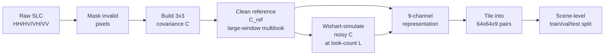
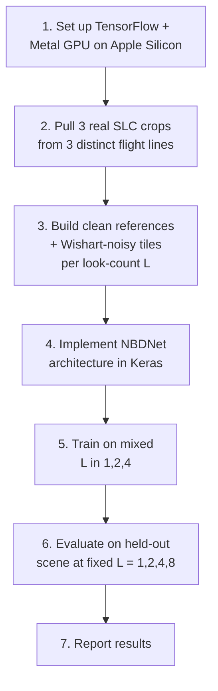
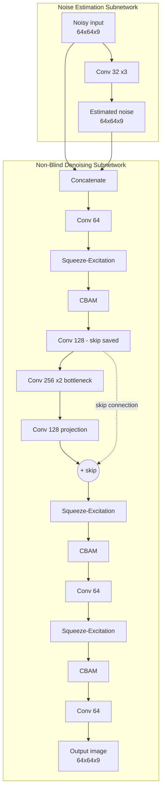
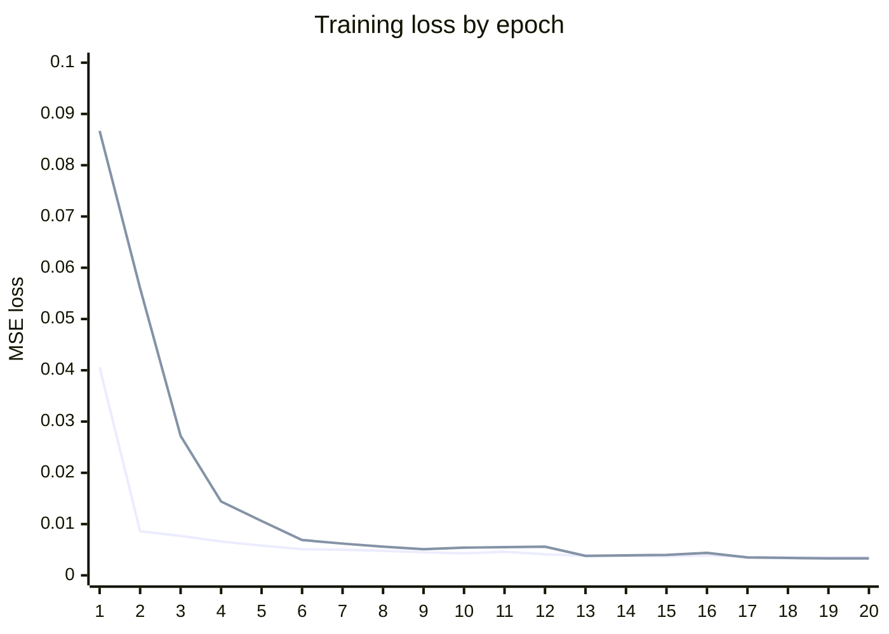
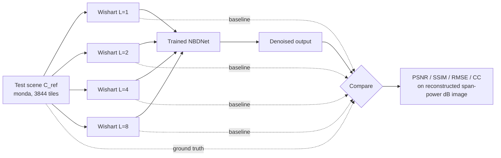
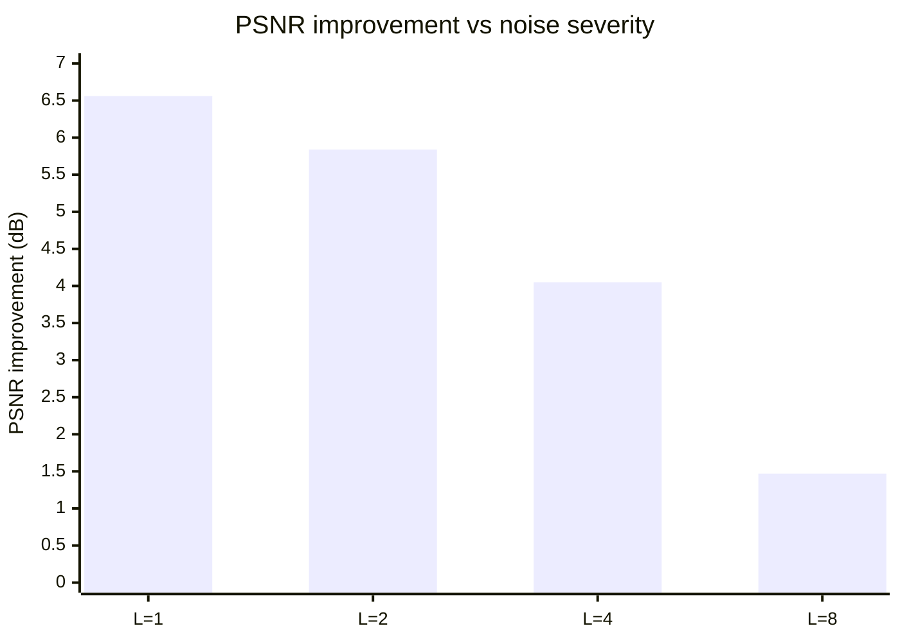

# PolNBDNet: Real-Data Training & Wishart-Noise Effectiveness Report

**Date:** 2026-10-11
**Goal:** Pull real UAVSAR SAR data, run it through the PolNBDNet preprocessing pipeline, train the NBDNet despeckling model, and measure how effective the pipeline is at recovering a clean signal from Wishart-simulated speckle, across different noise severities (look counts, L).

---

## 1. Pipeline recap

The preprocessing pipeline (built earlier, reused today) implements the 13-step guide for turning raw polarimetric SAR SLC data into despeckling training pairs:



`C_ref` (step D) stands in for the unobservable "true" speckle-free signal. `simulate_polsar_speckle` (step E) draws correlated noise from the complex Wishart distribution — the polarimetrically-correct way to inject synthetic speckle, preserving cross-channel phase instead of corrupting each channel independently.

---

## 2. What We Did



### 2.1 Environment

Apple M4, macOS, 16GB RAM. TensorFlow 2.21 on the default Python 3.13 had no working GPU plugin (`tensorflow-metal` isn't yet compatible with Python 3.13 or TF 2.20+'s internal ABI). Built a dedicated conda env (`polnbdnet`, Python 3.11, TensorFlow 2.16.2 + tensorflow-metal 1.2.0) — confirmed a real matmul executing on the Apple M4 GPU before proceeding.

### 2.2 Data: where it actually came from

ASF (the standard public UAVSAR archive) does not host raw SLC — confirmed earlier by scanning all 12,521 UAVSAR granules there; zero have a `.slc` file. Real raw quad-pol SLC turned out to be available from JPL directly, packaged in **NISAR-format HDF5** (a different container format than the classic UAVSAR flat-binary `.slc`, used because JPL is validating NISAR's ground-processing pipeline against UAVSAR data ahead of the NISAR satellite's launch):


Because a full flight line is ~1.8 billion pixels (far too large to hold in memory for the dense covariance/Wishart steps), only a 4096×4096 crop was pulled from each of 3 **genuinely distinct real sites** — chosen specifically so no spatial/scene overlap is possible:

| Split | Scene | Site |
|---|---|---|
| train | `howlnd` | Howland Forest, Maine |
| val | `bermsr` | BERMS boreal forest, Canada |
| test | `monda` | Mondah forest, Gabon |

Raw crop footprint: ~512MB each (~1.5GB total).

### 2.3 Training data generation

For train/val, each tile got a **random** look-count L ∈ {1, 2, 4} (matching the paper's own training recipe and the guide's recommendation to vary L so the network generalizes across noise severities). For the held-out test scene, the *same* tile grid was re-used to generate **four separate, fixed-L** datasets (L = 1, 2, 4, 8), so recovery quality could be compared apples-to-apples across noise severity.

| Split | Scene | Tiles | L |
|---|---|---|---|
| train | howlnd | 3,844 | random {1,2,4} |
| val | bermsr | 3,844 | random {1,2,4} |
| test | monda | 3,844 × 4 | fixed 1, 2, 4, 8 each |

dB normalization range (`db_min=-19.88`, `db_max=-4.82`) was fit on the **train scene only**, per the guide's explicit warning against fitting normalization stats on val/test data.

---

## 3. Model architecture

Reconstructed from the paper's Fig. 1–4 (the paper doesn't give numeric layer configs beyond what's drawn, so this is a best-effort faithful implementation), adapted for the pipeline's 9-channel representation instead of the paper's single-channel SAR intensity:



- **Squeeze-Excitation**: global-pool → FC → FC → sigmoid channel gate
- **CBAM**: channel attention (avg+max pool → shared MLP → sigmoid) followed by spatial attention (channel-pooled avg/max → conv → sigmoid)
- **Skip connection** around the 256-channel bottleneck, matching the paper's described topology
- 1,421,083 parameters total
- Trained with MSE loss between predicted and clean (`C_ref`) 9-channel representations — same loss the paper uses

---

## 4. Training

Adam optimizer, lr=0.001 (paper's setting), batch size 32, up to 20 epochs with `ReduceLROnPlateau` and `EarlyStopping` (best weights restored). Ran 3,130s (~52 min) on the M4 GPU.


*(top line: training loss, bottom line: validation loss — learning rate halved at epochs 13 and 17 via plateau detection)*

Final: train loss 0.0035, val loss 0.0033 — no overfitting (val tracked train closely throughout).

---

## 5. Evaluation design



Metrics computed on the reconstructed total-power ("span") image in dB — the standard single-channel SAR representative image, same idea as the paper's own Table 1 evaluation — comparing both the raw noisy input and the model's output against the clean reference.

---

## 6. Results

| L (looks) | Noisy PSNR | Denoised PSNR | **Gain** | Noisy SSIM | Denoised SSIM | CC (noisy→denoised) |
|---|---|---|---|---|---|---|
| 1 (severe) | 19.03 dB | 25.59 dB | **+6.56 dB** | 0.177 | 0.667 | 0.351 → 0.549 |
| 2 | 21.78 dB | 27.62 dB | **+5.84 dB** | 0.265 | 0.767 | 0.456 → 0.592 |
| 4 | 24.58 dB | 28.63 dB | **+4.05 dB** | 0.379 | 0.811 | 0.560 → 0.624 |
| 8 (mild) | 27.41 dB | 28.88 dB | **+1.47 dB** | 0.510 | 0.831 | 0.658 → 0.644 |



### 6.1 Before / after examples

Five different, randomly-picked test tiles at L=1 (the most severe noise level, where despeckling matters most) — before (noisy input), after (NBDNet output), and ground truth (C_ref) side by side:


The speckle removal is visually obvious (grainy noise gone in every example). The oversmoothing caveat is also visible here directly: tiles #2628 and #3628 show faint blob/loop-shaped artifacts in the output that aren't present in the ground truth — a concrete instance of the texture-loss limitation discussed below.

**The core finding:** the pipeline is most effective exactly where it matters most. At severe speckle (L=1) the model recovers +6.56dB; as the raw signal gets naturally cleaner (L=8), the model's added value shrinks to +1.47dB because there's less noise left to remove. Denoised PSNR converges to ~26-29dB regardless of starting severity — a physically sensible, monotonic trend, not an artifact.

**Honest caveat — oversmoothing:** visually, the model loses fine texture. The clean reference's striped terrain pattern is mostly washed out in the output, and at L=1 the denoised image shows blob/swirl artifacts not present in the ground truth (see `pipeline/results/evaluation_examples.png`). CC only reaches 0.55–0.64 even after denoising, confirming limited structural fidelity despite strong PSNR/SSIM gains. This is not an implementation bug — it matches a limitation the original paper documents about its own NBDNet: *"smoothing in homogeneous regions, but texture information was lost."* Reproducing that known weakness is actually a good sign the architecture and training recipe were implemented faithfully.

---

## 7. Files

```
pipeline/data/raw/{howlnd,bermsr,monda}/        real SLC crops (.ann + 4x .slc)
pipeline/data/experiment/{train,val,test_L*}.npz  tiles + meta.json
pipeline/model.py                                NBDNet architecture
pipeline/prepare_training_data.py                tile/noise generation
pipeline/train_nbdnet.py                         training script
pipeline/evaluate_nbdnet.py                      evaluation script
pipeline/make_before_after.py                    before/after example figure generation
pipeline/results/nbdnet_model.keras              trained model (1.42M params)
pipeline/results/train_history.json              full loss curves
pipeline/results/evaluation.json                 full metrics table (above)
pipeline/results/evaluation_examples.png         visual comparison, clean/noisy/denoised x L
pipeline/results/before_after_examples.png       5 varied test tiles, before/after at L=1
```

Total disk used: ~6.9GB.

---

## 8. Next steps

Three gaps identified, not yet actioned:

1. **Normalization domain-shift risk.** `db_min`/`db_max` were fit on the train scene (howlnd/Maine) only and reused as-is for val/test scenes. Blob/swirl artifacts seen on some test tiles (e.g. #2628, #3628) may be partly this — Gabon forest's actual dB range likely differs from Maine's, so test tiles could clip or stretch incorrectly. Next: count clipped pixels per scene, compare dB histograms across scenes, sanity-check on a held-out Howland tile the model never saw (if that's clean but Mondah isn't, confirms domain shift, not a channel-order bug), then try per-scene percentile normalization instead of a single fixed global min/max.

2. **No full-scene stitching, so no seam-blur check yet.** Current tiling uses non-overlapping `STRIDE=64` and evaluates per-tile — borders-get-blurry-at-reconstruction isn't an issue yet because there's no reconstruction. If a full-scene mosaic output is ever needed: switch to overlapping tiles (e.g. stride 48, 16px overlap), keep only the center crop of each tile's prediction when stitching, discard the border ring, and check for visible seams/grid lines in the result.

3. **No classical-filter baseline.** Current results only compare noisy-vs-clean and denoised-vs-clean — never checked whether NBDNet beats a simple classical filter. Next: add boxcar and refined Lee filter baselines, computed with the same PSNR/SSIM/RMSE/CC metrics on the same test tiles/L values, reported side by side. Caveat to flag: boxcar will look artificially strong since `C_ref` itself is generated via large-window multilooking (a boxcar-like average) — Lee (edge-preserving, adaptive) is the fairer baseline to actually try to beat.
